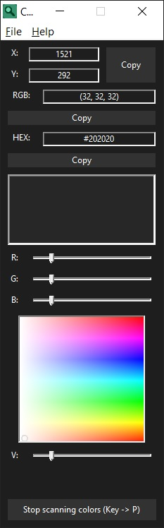

# Color Picker

## Screenshot



*Interface*

## Description

**Color Picker** is a small Windows program written in C using the WinAPI. It allows you to pick the color of any pixel on the screen, displays its coordinates, RGB and HEX values, and also lets you manually select a color using a color wheel and sliders.

The program requires no third‑party libraries and can be compiled with a standard C compiler for Windows.

## Features

- Get the color of the pixel under the cursor.
- Display coordinates, RGB and HEX values.
- Keyboard controls (`P` – start/stop, `WASD`/arrow keys – fine cursor movement).
- Simple 10× magnifier.
- Color wheel (Hue/Saturation) + brightness (Value) slider.
- System tray and a minimal “About” window.

## Controls

- `P` – start / stop color picking.
- Mouse – select a color directly on the color wheel.
- `Copy` buttons – copy coordinates or color values to the clipboard.

## Build

To build you need GCC (MinGW) and the Windows SDK:

```bash
gcc main.c -o color_picker.exe -lgdi32 -lcomctl32
```

Or using `make` (if you have it installed):

```bash
make
```

## Clean

```bash
make clean
```

Removes the executable and temporary object files.

## License

**MIT** – free to use and modify.

---

Author: [Tailogs](https://github.com/tailogs)